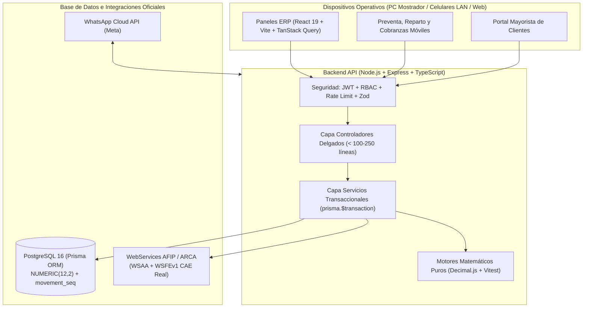

# Spec 00: Arquitectura Global y Estándar Modular (`ERP-CRM DV`)

## 1. Propósito del Sistema
**ERP-CRM DV** es el sistema central contable, logístico, comercial y financiero de la distribuidora mayorista.
Su diseño prioriza tres pilares innegociables:
1. **Exactitud financiera y de stock al 100%** (cero centavos fantasma, snapshots históricos inmutables y trazabilidad auditable).
2. **Seguridad operativa y control de accesos estricto** por rol (`ADMIN`, `FACTURACION`, `VENDEDOR`, `DEPOSITO`) y aislamiento para clientes web.
3. **Arquitectura modular anti-espagueti** (4 capas claras con objetivo de `250–300` líneas y techo flexible de `450` líneas por cohesión, prohibiendo fragmentar transacciones atómicas).

---

## 2. Topología Real del Sistema



---

## 3. Separación Estricta en 4 Capas

Los archivos nuevos o refactorizados apuntan a una **zona ideal de `150–300` líneas** con un **techo flexible de hasta `450` líneas cuando conforman una única unidad cohesiva** (evitando partir transacciones atómicas a la fuerza), respetando estrictamente las 4 capas:

1. **Capa 1 — Núcleo y Motores Matemáticos (`backend/src/core/*.ts` y `backend/src/engines/*.engine.ts`)**:
   - Funciones puras con `Decimal.js` (`precision: 20`, `ROUND_HALF_UP`).
   - Sin acceso a Express ni a Prisma. Cubiertos con tests automáticos en `Vitest`.
2. **Capa 2 — Contratos de Validación (`backend/src/validators/*.validator.ts`)**:
   - Validación estricta de `body`, `query` y `params` con `Zod` antes de tocar cualquier controlador.
3. **Capa 3 — Controladores Delgados y Servicios de Dominio (`backend/src/controllers/` y `backend/src/services/`)**:
   - Los controladores solo extraen datos validados, verifican identidad/permisos y responden HTTP.
   - Los servicios ejecutan reglas de negocio y persistencia atómica mediante `prisma.$transaction`.
4. **Capa 4 — Pantallas Modulares (`frontend/src/components/`)**:
   - Cada panel se divide en pestañas (`*Tab.tsx`), modales aislados (`*Modal.tsx`) y hooks controladores (`use*Controller.ts`).

---

## 4. Estructura Oficial del Repositorio

```text
ERP-CRM DV/
├── .agents/                         # Reglas operativas (AGENTS.md), skills y tablero vivo (task.md)
├── .specify/                        # Constitución innegociable y plantillas de GitHub Spec Kit
├── ARCHIVOS/fotos/Productos/        # Repositorio maestro e inmutable de imágenes ([SKU].[ext])
├── specs/                           # Fuente Única de Verdad (SSOT) de arquitectura e invariantes
├── backend/
│   ├── prisma/                      # schema.prisma y migraciones sagradas (--create-only)
│   └── src/
│       ├── config/                  # Validación estricta de variables de entorno
│       ├── core/                    # money.ts (Decimal.js), search.ts, geo.ts, errors.ts
│       ├── engines/                 # pricing, orders, stock y treasury engines
│       ├── middlewares/             # auth.ts (JWT + RBAC), rateLimiter, validateRequest, errorHandler
│       ├── validators/              # Esquemas Zod de entrada
│       ├── services/                # Submódulos por dominio (catalog/, orders/, personas/, admin/, etc.)
│       ├── controllers/             # Controladores HTTP delgados
│       └── routes/                  # Definición de endpoints protegidos
└── frontend/
    └── src/
        ├── components/              # Vistas modulares por área (admin/, deposito/, finanzas/, compras/, etc.)
        ├── hooks/                   # Hooks de estado y consultas React Query
        └── utils/                   # Cliente API tipado, helpers de impresión A4 y utilidades GPS
```
