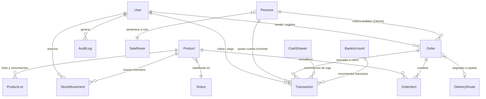

# Invariantes y Reglas de Base de Datos (PostgreSQL & Prisma)

Este documento contiene las reglas de oro técnicas, invariantes sagradas y diseño relacional de la base de datos de **ERP-CRM DV**. Cualquier agente que altere la base de datos DEBE cumplir este protocolo al 100%.

---

## 1. Diagrama de Entidad-Relación (ER Overview)



---

## 2. Regla Sagrada de Migraciones: Flujo Seguro `--create-only`

PostgreSQL maneja objetos nativos como secuencias (`movement_seq`) que Prisma desconoce en su esquema declarativo. Por ello, Prisma intenta borrarlas (`DROP SEQUENCE`) por defecto.

### Protocolo Obligatorio para Cambios de Esquema:
1. **Modificar** `backend/prisma/schema.prisma`.
2. **Generar la migración sin aplicar**:
   ```bash
   cd backend
   npx prisma migrate dev --name <nombre_descriptivo> --create-only
   ```
3. **Revisar y Limpiar el archivo SQL generado**:
   - Abrir el archivo `backend/prisma/migrations/<timestamp>_<nombre>/migration.sql`.
   - **ELIMINAR** cualquier línea que contenga `DROP SEQUENCE` (especialmente `movement_seq`).
   - Si la migración toca movimientos o tablas contables, asegurar al inicio:
     ```sql
     CREATE SEQUENCE IF NOT EXISTS movement_seq START WITH 1 INCREMENT BY 1;
     ```
4. **Aplicar la migración de forma segura**:
   ```bash
   npx prisma migrate deploy
   ```
5. **Regenerar el cliente Prisma**:
   ```bash
   npx prisma generate
   ```

> [!CAUTION]
> **NUNCA** ejecutar `npx prisma migrate dev` directamente sin `--create-only`.
> **NUNCA** editar archivos de migraciones pasadas que ya estén aplicadas.

---

## 3. Rigor Financiero: Tipos Decimales Obligatorios

- Para todo valor monetario, precio unitario, subtotal, IVA, total facturado o saldo de deuda, se debe usar estrictamente el tipo `Decimal` en Prisma (`@db.Decimal(12, 2)` o similar).
- **Prohibido usar `Float`** para dinero para evitar errores de redondeo de punto flotante en cálculos fiscales y cuentas corrientes.

---

## 4. Secuencias Continuas para Movimientos (`movement_seq`)

- Los números de movimientos de stock y comprobantes internos no deben tener huecos.
- El campo `movementId` o comprobante se alimenta de la secuencia nativa PostgreSQL `movement_seq`.
- En seeds y scripts de prueba, **nunca definir manualmente valores en campos de secuencias autogeneradas**.

---

## 5. Planilla Maestra (`Maestro1.xlsx`) como SSOT

- La planilla `Maestro1.xlsx` en la raíz es la fuente primaria de datos iniciales (clientes, productos, listas de precios, rutas).
- Los scripts de sincronización (en Python o Node.js) deben operar en modo `upsert`:
  - No duplicar registros existentes si el código de producto (SKU) o CUIT del cliente ya existe.
  - Actualizar precios y descripciones manteniendo la integridad referencial de los históricos de ventas.

| Solapa en `Maestro1.xlsx` | Modelo Prisma Destino | Acción de Sincronización |
| :--- | :--- | :--- |
| **`Clientes`** | `Persona` (`isClient: true`) | Busca por CUIT/Nombre: Actualiza datos si existe, crea nuevo si no. |
| **`Productos`** | `Product` + `Rubro` | Busca por SKU: Actualiza costo/lista/bultos si existe, crea nuevo si no. |
| **`Listas`** | `Product.listPrice`, `listPriceB`, `listPriceC` | Actualiza precios A, B y C de manera masiva. |
| **`Rutas`** | `SaleRoute` / `route` | Registra/Actualiza días de venta y reparto de preventa. |
| **`Bancos`** | `BankAccount` | Sincroniza nombres de cuenta y CBU/Alias. |

---

## 6. Inmunidad del Repositorio Maestro de Fotos

1. **Ubicación Maestra**: `ARCHIVOS/fotos/Productos/` es inmutable.
2. **Nomenclatura**: Estrictamente `[SKU].[ext]` (ej. `0052.jpg`).
3. **Prohibición**: Ningún agente ni script tiene permiso de renombrar, desplazar numéricamente (+1 / -1) o eliminar fotos maestras.
4. **Auto-Restauración**: El backend (`backend/src/app.ts`) copia/sincroniza en cada inicio las fotos hacia `backend/uploads/products/`, garantizando que la UI siempre tenga acceso a las imágenes sin poner en riesgo los archivos originales.
